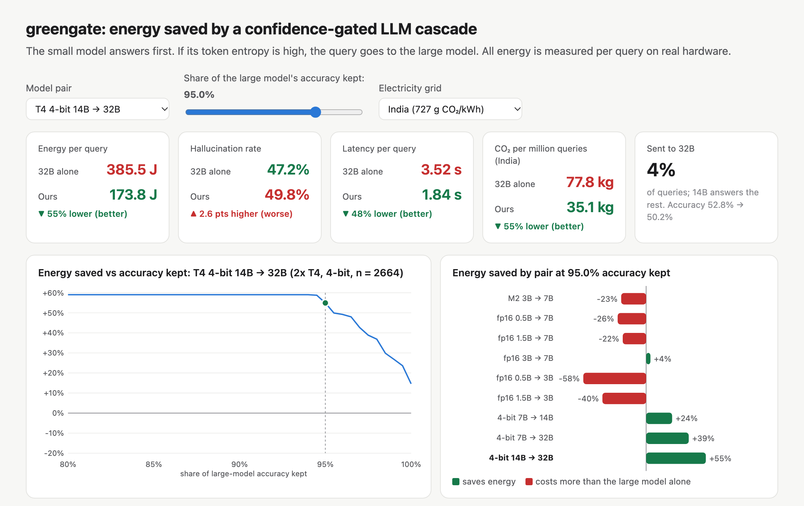

. : File C:\Users\Lenovo\OneDrive\Documents\WindowsPowerShell\profile.ps1 cannot be loaded because running scripts is 
disabled on this system. For more information, see about_Execution_Policies at 
https:/go.microsoft.com/fwlink/?LinkID=135170.
At line:1 char:3
+ . 'C:\Users\Lenovo\OneDrive\Documents\WindowsPowerShell\profile.ps1'
+   ~~~~~~~~~~~~~~~~~~~~~~~~~~~~~~~~~~~~~~~~~~~~~~~~~~~~~~~~~~~~~~~~~~
    + CategoryInfo          : SecurityError: (:) [], PSSecurityException
    + FullyQualifiedErrorId : UnauthorizedAccess
# GreenGate

### When does confidence gated routing make LLM inference more energy efficient?

GreenGate is a measurement study of energy aware language model cascades. A smaller model answers first; a confidence gate can send difficult questions to a larger model. The study measures the energy spent on both calls, including draft work discarded after escalation.

**Explore the interactive dashboard:** [Open the live dashboard](https://anas255-exe.github.io/Energy-Efficient-LLM-Inference-using-Confidence-Gated-Model-Routing/)

  

## Key findings

The preprint studies nine draft to target model pairs, from Qwen2.5 0.5B to 32B, on Apple M2 and NVIDIA T4 hardware. Its results show that the energy benefit depends strongly on model scale and the accuracy retention required. In the reported 0.5B to 7B through 3B to 7B pairs, retaining 95% of the large model's accuracy ranges from 58% more energy to 4% less energy. Larger measured pairs can save more: the paper reports 24% savings for 7B to 14B, 39% for 7B to 32B, and 55% for 14B to 32B at the same retention target.

The interactive dashboard lets readers explore the paper's model pair, accuracy retention, and electricity grid assumptions. See the paper and results for measurement details, caveats, confidence intervals, and dataset splits.

## Repository map

| Path | Contents |
| --- | --- |
| [`index.html`](index.html) | Self contained dashboard served by GitHub Pages |
| [`paper/greengate_paper.docx`](paper/greengate_paper.docx) | Formatted paper draft |
| [`paper/draft.md`](paper/draft.md) | Editable paper source |
| [`paper/figures/`](paper/figures/) | Figures used by the paper |
| [`src/`](src/) | Data preparation, inference, analysis, routing, and figure scripts |
| [`RESULTS.md`](RESULTS.md) | Detailed experiment results and caveats |
| [`results_eval/`](results_eval/) | Evaluation summaries and transfer analysis |
| [`results_kaggle/`](results_kaggle/) | GPU replication results |
| [`results_big/`](results_big/) | Larger model experiment results |
| [`kaggle/`](kaggle/) | Kaggle scripts and notebooks |

## Open the dashboard locally

The dashboard is a single HTML file with its data embedded. Open [`index.html`](index.html) in a modern browser; no server, build step, or third party JavaScript is required.

## Reproduce the experiments

The primary Apple Silicon pipeline uses Python 3.11, MLX, and `macmon`. The GPU replication uses NVIDIA hardware and the corresponding Kaggle notebooks. Experiments can require large model downloads and significant compute. Results included here allow readers to inspect the reported outputs without rerunning them.

The original setup and command sequence are documented in [`paper/draft.md`](paper/draft.md), [`src/`](src/), and the Kaggle notebooks. Hardware specific commands may need adjustment for the environment used. The archived question files and results are included as provided in the research bundle.

## Paper

**Energy Efficient LLM Inference using Confidence Gated Model Routing**  
Mohammad Anas, Nishit Singhal, Krish Garg, and Aarush Singh  
Department of Computer Science & Engineering, Delhi Technological University  
Advisor: Dr. Neha Gupta  
Preprint, November 2026

This is a preprint draft. Please cite the authors and paper title if you use this work. No DOI or formal publication details were supplied with the source archive.

## Deployment

GitHub Pages is configured to publish the repository root from the `main` branch using GitHub Actions. Once the repository is pushed to GitHub, enable Pages with **GitHub Actions** as the build and deployment source in the repository's **Settings → Pages**. The workflow publishes `index.html` and the paper assets without a frontend build.

GitHub Pages will serve the dashboard at `https://anas255-exe.github.io/Energy-Efficient-LLM-Inference-using-Confidence-Gated-Model-Routing/` after the first push and Pages deployment.

## License and data

No software or data license was provided in the source archive. This repository therefore does not grant reuse rights. The dataset files and third party model references remain subject to their original terms; consult their upstream sources before redistribution or reuse.

